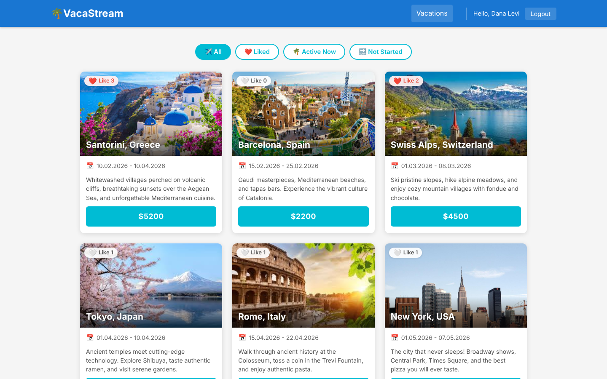
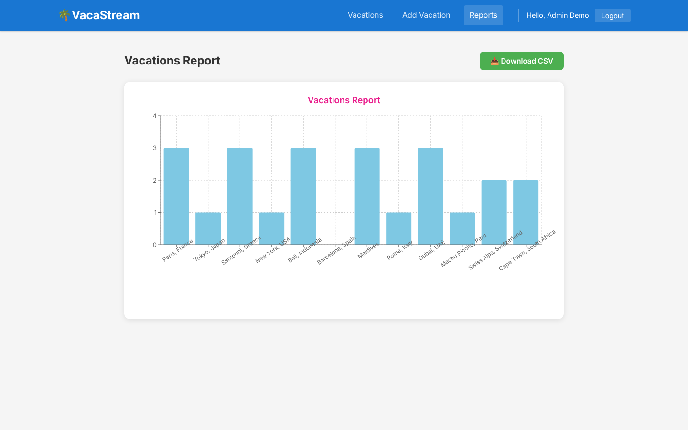

# VacaStream

A vacation browsing platform built as microservices: users browse vacations and like the ones they want, and admins manage vacations and see reports. The whole system runs with one `docker compose up`.





## Features

**Users**
- Register and log in (JWT authentication, bcrypt password hashing)
- Browse vacations and like / unlike them

**Admins**
- Add, edit and delete vacations, including image upload
- Likes report as a chart (Recharts) and as a downloadable CSV

## Tech Stack

**Backend:** Node.js · Express 5 · TypeScript · MySQL (mysql2) · JWT · bcrypt · Helmet · express-rate-limit · http-proxy-middleware · Multer
**Frontend:** React · TypeScript · Redux Toolkit · React Router · Recharts · Vite
**DevOps:** Docker · Docker Compose · Nginx · pnpm workspaces (monorepo)

## Architecture

```
Browser --> Frontend (React, served by Nginx, port 80)
              |
              v
          API Gateway (port 3000): JWT verification, rate limiting, Helmet, proxy
            |                     |
            v                     v
     Auth service (3001)   Vacation service (3002)
            \                     /
             +----> MySQL <------+
```

- **Gateway** – single entry point; verifies the JWT and forwards requests to the right service
- **Auth** – registration and login
- **Vacation** – vacations CRUD, likes, image uploads, reports and CSV export
- **Libraries/@YD** – internal shared packages (`jwt`, `restify`) used by the services

## API (through the gateway)

| Method | Endpoint | Access |
|--------|----------|--------|
| POST | `/api/auth/register`, `/api/auth/login` | Public |
| GET | `/api/vacations`, `/api/vacations/:id` | Logged in |
| POST / DELETE | `/api/likes/:vacationId` | User |
| POST / PUT / DELETE | `/api/vacations`, `/api/vacations/:id` | Admin |
| GET | `/api/reports`, `/api/reports/csv` | Admin |

A Postman collection is in `postman/`.

## Run with Docker (recommended)

```bash
cp .env.example .env      # set MYSQL_ROOT_PASSWORD and JWT_SECRET
docker compose up --build
```

Open `http://localhost`. The database is created and seeded automatically from `Database/schema.sql`.

**Demo users**

| Role | Email | Password |
|------|-------|----------|
| Admin | admin@demo.com | Admin1234! |
| User | dana@demo.com | User1234! |

## Run without Docker

Requirements: Node.js 20+, pnpm, MySQL with `Database/schema.sql` imported.

```bash
pnpm install
pnpm build
cp Backend/Auth/.env.example Backend/Auth/.env           # same for Gateway and Vacation
pnpm dev     # Gateway 3000, Auth 3001, Vacation 3002, Frontend 5173
```

## What I Learned

- Splitting a backend into services behind an API gateway, and sharing code between them as internal packages
- Containerizing a multi-service system with Docker Compose: health checks, volumes, service dependencies
- Role-based access control with JWT

## Author

Yuval Dromi · [GitHub](https://github.com/yuvaldromi1)
